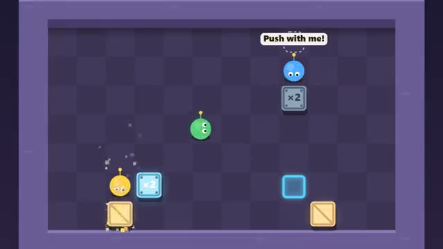

# Crate Pushers

Push every crate onto its pad. Steel takes two. A multiplayer starter game from [Multiplayer Agent](https://multiplayeragent.com): 2D, co-op, 1–4 players, with a buddy bot when you play alone.

## How it plays

Walk into a crate to push it and get every crate onto a matching pad. Steel crates only move when two of you line up behind and push together. Stuck? Vote to undo the last push or reset the level. Five hand-made levels.

**Controls:** Arrow keys or WASD, Z to undo, R to reset; on touch, the D-pad or drag on the level.

## Make it yours in the Game Builder

Open the [Game Builder](https://multiplayeragent.com), choose **Start from a starter game** and pick Crate Pushers. It opens as version 1 in your studio, ready to play and publish. Then ask for changes, for example:

- Add ice tiles that make crates slide until they hit a wall
- Add a level where a crate needs three pushers
- Turn the warehouse into a pirate ship with treasure chests

## Run it yourself

1. Get a free publishable key (`pk_…`) at [multiplayeragent.com](https://multiplayeragent.com).
2. In `index.html`, put it in place of `pk_REPLACE_ME` in the `MP_CONNECT` block.
3. Open `index.html` in a browser. No build step and no server needed.

Without a key it still runs, offline with a buddy bot.

## How it is built

- One `index.html`. The comment at the top of the script maps the code and explains the multiplayer.
- The levels are text maps in `CONFIG.levels`: `#` walls, `.` floor, `c` wood crates for `o` pads, `h` steel crates for `O` pads, `s` spawns. Draw a new map to add a level.
- **Host-run rules:** The host's browser moves the crates and checks who is pushing; if it leaves, the next player takes over.
- **Bots:** Alone? A buddy bot pushes wood crates, backs you up on steel ones and asks for a hand.
- **Leaderboard:** The fastest crew through all five levels.
- **Live sync:** Everyone walks, pushes and votes in the same warehouse.
- `?attract` runs it offline with bots only. The preview video is recorded from it.

## License

MIT.
